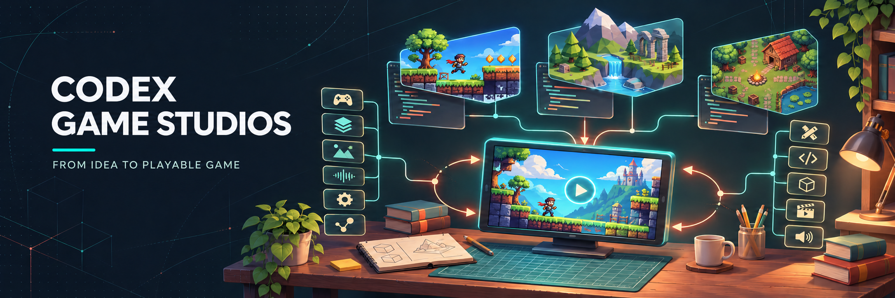
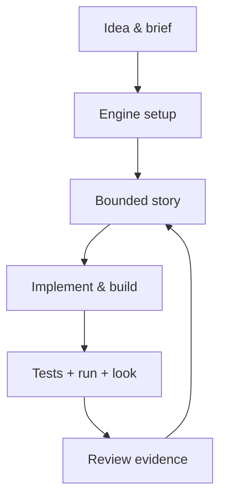
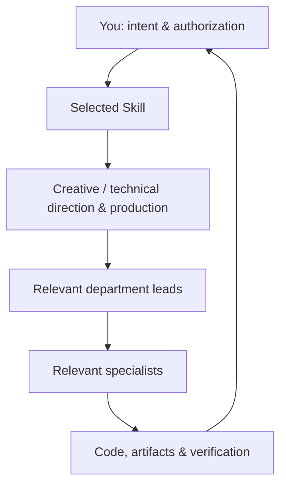

<div align="center">

<h1>
  
</h1>

A game development toolkit for OpenAI Codex.<br>
74 Skills · 49 specialist roles · Web, Godot, Unity & Unreal Engine

[](https://github.com/ScrabyQ/Codex-Game-Studios/actions/workflows/codex-ci.yml)
[](LICENSE)
[](https://learn.chatgpt.com/docs/build-skills)
[](.agents/skills)
[](.codex/agents)
[](#engine-support)

**[Get started](#quick-start) · [Explore the workflow](docs/WORKFLOW-GUIDE.md) · [Contribute](CONTRIBUTING.md)**

Adapted and maintained by [ScrabyQ](https://github.com/ScrabyQ),<br>
based on [Claude Code Game Studios by Donchitos](https://github.com/Donchitos/Claude-Code-Game-Studios).

</div>

---

## Why this exists

A useful coding assistant can still lose the thread of a game: the design lives in one conversation, implementation in another, and testing becomes something to do later. Solo and indie developers need a way to keep those decisions connected while continuing to build.

Codex Game Studios brings structure to that work. Skills guide bounded tasks, specialist roles define responsibilities, and shared settings scale the process from a short game brief to reviewed design and architecture. You choose the next step and authorize changes; the toolkit keeps requirements, code and evidence connected.

The goal is a game you can actually open and inspect. A passing parser or a folder full of documents does not establish playability. Player-visible changes call for a real run and retained screenshots; human playtesting answers the questions that automated checks cannot.

## What's included

| Component | What it gives you |
| --- | --- |
| **[74 Skills](.agents/skills)** | Onboarding, concepts, prototypes, design, architecture, stories, implementation, QA and release preparation |
| **[49 specialist roles](.codex/agents)** | Creative and technical direction, department leads, programmers, artists, audio, narrative, production and QA |
| **[14 path policies](.agents/rules)** | Relevant coding, scene, data and authoring rules selected explicitly for the files being changed |
| **[73 template and guidance files](.agents/docs/templates)** | Starting points for briefs, GDDs, ADRs, stories, UX, test plans and other project documents |
| **[Shared configuration](project.yaml)** | Project settings, allowed local overrides, process depth and engine routing |
| **[Safety and lifecycle adapters](docs/codex/hooks.md)** | Explicit proposal checks, write validation, recovery checkpoints and delegated-return observations |
| **[Executable checks](docs/codex/testing.md)** | Configuration, native formats, integrity, helper behavior, refusals and reviewed update regressions |
| **[Engine references](docs/engine-reference)** | Version-aware guidance for Godot, Unity and Unreal Engine |

Written behavior specs live in [studio-tests](studio-tests). Counts above describe the maintained native product; written specs are not automatically executed model tests.

## Quick start

You need **Git** and a configured **Codex client**. Helpers and checks also need **Node.js 22 or 24, Bash and Python 3**. On Windows, Git for Windows supplies Bash; `CGS_BASH` can select another installation. Install the engine and toolchain only for the game you intend to build.

```sh
git clone https://github.com/diepdo1810/Codex-Game-Studios-TitMit.git
cd Codex-Game-Studios-TitMit
codex
```

Or open the cloned folder in the Codex desktop app. In the **Codex conversation**, enter:

```text
$start
```

`$start` inspects the project and guides onboarding. When you want the next useful step:

```text
$help
```

These are Skill inputs in Codex, not terminal commands. A recommendation does not automatically start another Skill. See [onboarding](docs/codex/onboarding.md) for discovery, permissions and client details.

**Already have a game?** Keep its repository and preserve its settings. Prepare a reviewed integration/update branch before bringing toolkit files into it; do not copy the whole toolkit over customized content. Once integrated, open that game folder in Codex, run `$start` and choose **Existing work**. The documented route is `$project-stage-detect` → `$adopt` → address the highest-risk gaps. See the [workflow guide](docs/WORKFLOW-GUIDE.md) and [update guidance](UPGRADING.md).

## Choose the process your game needs

Set `modes.rigor` through `$settings`. Rigor expands into workflow, review, QA, document density, story granularity and team size unless a permitted explicit setting overrides it.

| Rigor | Typical working path | The trade |
| --- | --- | --- |
| **`minimal`** | One-page brief → bounded stories → implementation, real run and visual check | Less documentation and fewer formal reviews; design gaps surface during building |
| **`standard`** | System design, critical architecture decisions, stories and broader test evidence | More preparation and traceability |
| **`full`** | Comprehensive design, architecture and formal review gates | The most process and maintenance; choose it when the scope warrants it |

More process does not guarantee a better game. Modes never grant permissions. See [configuration resolution](.agents/docs/config-resolution.md) before pinning individual knobs that override rigor.

## How the studio works



Skills keep the task bounded. Roles supply the relevant expertise:



This is a responsibility map, not an always-running team. Actual delegation depends on the host and authorization. A disclosed in-session role review remains useful, but cannot count as independent review. Model preferences in [.codex/model-policy.json](.codex/model-policy.json) are resolved against actual host/account capabilities; a role name does not guarantee a particular model.

## Engine support

| Engine | Specialist guidance | Actual execution requires |
| --- | --- | --- |
| **Web / Browser** | Canvas 2D, Phaser, PixiJS, Three.js using Vite + TypeScript | Node.js, a browser, and project dependencies; browser verification requires Playwright or a supported browser |
| **Godot 4** | GDScript, C#, shaders, GDExtension, scenes and tests | A matching installed Godot editor and the project's test setup |
| **Unity** | C#, DOTS/ECS, UI, shaders, Addressables and tests | The matching editor, license and project/package dependencies |
| **Unreal Engine 5** | C++, Blueprints, GAS, replication, UMG and tests | A valid project, editor, compiler and required SDKs |

`$setup-engine web` uses the pinned [Web scaffold](.agents/engines/web/UPSTREAM.md) and follows [Web setup](docs/engine-reference/web/SETUP.md); it detects existing `package.json` games without overwriting them. `$setup-engine` verifies the editor for native engines and configures the project. Consult the selected [version reference](docs/engine-reference) before engine work. Guidance for an engine is separate from having run its editor, tests or export pipeline.

Engine and paid native-client checks are **opt-in**. Ordinary CI covers the toolkit on Node 22/24, with backend jobs on Linux, Windows and macOS Intel. It does not certify a game's visual quality, performance or human experience.

## Quality, recovery and permissions

- **Check real artifacts.** Missing inputs and unperformed checks stay **NOT ASSESSED** or **PENDING**.
- **Run and look.** Retain and inspect screenshots for player-visible changes; a parse check is not a run.
- **Review changes before applying them.** Existing authorization persists; an unanswered required question is not consent.
- **Use explicit checks.** The [hook example](.codex/hooks.example.json) is inactive until reviewed and verified in the installed client. Path policies and CLI adapters do not claim automatic host enforcement.
- **Recover from the checkpoint.** Read ignored `production/session-state/active.md` after interruption when present.

From the repository root, validate the product and run its ordinary CI checks. If this repository was created using **Use this template**, GitHub copies the product files but may omit the pinned upstream source Git objects required by the deterministic generator checks. Fetch the **reviewed, pinned upstream commit** once (read-only for the working tree):

```sh
git fetch --no-tags --depth=1 https://github.com/Donchitos/Claude-Code-Game-Studios.git 05ad7c8a5b8aa2aa86bbd3439ae7cf7295cac418:refs/heads/source/ccgs-main
```

The source branch is a Git maintenance ref, not a project branch to merge. This fetch does not overwrite your game files.

Then validate and run CI:

```sh
node scripts/codex/validate.mjs
node scripts/codex/ci.mjs
```

Start with the [workflow guide](docs/WORKFLOW-GUIDE.md), [testing](docs/codex/testing.md) and [hook integration](docs/codex/hooks.md) for backend checks, disposable checkouts and opt-in engine/client tests.

## Make it yours

Edit native Skills in `.agents/skills/` and roles in `.codex/agents/` with a bounded spec and review. Use the source-free registration and selected integrity-update commands in [CONTRIBUTING.md](CONTRIBUTING.md). Keep game content and project-specific settings under your own version control.

Normal use and native authoring work **offline**. Maintainers can separately inspect original-source changes through the [reviewed upstream import](docs/codex/upstream-sync.md). It preserves attribution and history, creates isolated candidates, and requires review and testing before publication.

## FAQ

<details>
<summary><strong>Do I need Claude Code or an upstream checkout?</strong></summary>

No. The maintained product uses native Codex Skills and roles. Original-source inspection is an optional maintainer workflow.
</details>

<details>
<summary><strong>Will all 49 roles launch automatically?</strong></summary>

No. Use only the roles relevant to the task. Delegation and model overrides require actual host support and existing authorization.
</details>

<details>
<summary><strong>What if Codex does not discover a Skill?</strong></summary>

Use the factual fallback documented in [onboarding](docs/codex/onboarding.md): ask Codex to read `.agents/skills/help/SKILL.md`, inspect actual project files and report unknowns. Reading a role in-session does not prove native child spawning.
</details>

<details>
<summary><strong>Does more documentation mean a better game?</strong></summary>

No. Choose the smallest process that provides the evidence your project needs. Run the game and collect human feedback to judge the experience.
</details>

<details>
<summary><strong>Where should test logs and screenshots go?</strong></summary>

Temporary or ignored storage, CI artifacts, the issue tracker or a PR. Do not add raw execution reports, credentials or machine-specific dumps to the toolkit.
</details>

## Contribute

Bug fixes, better native workflows, focused regressions and clearer guidance are welcome. Read [CONTRIBUTING.md](CONTRIBUTING.md), explain the concrete behavior change, and include meaningful validation and any limits.

## Credits & license

**Codex adaptation and maintenance:** [ScrabyQ](https://github.com/ScrabyQ).<br>
**Original project:** [Claude Code Game Studios](https://github.com/Donchitos/Claude-Code-Game-Studios) by **Donchitos**.<br>
The original copyright notice and [MIT license](LICENSE) are preserved.
