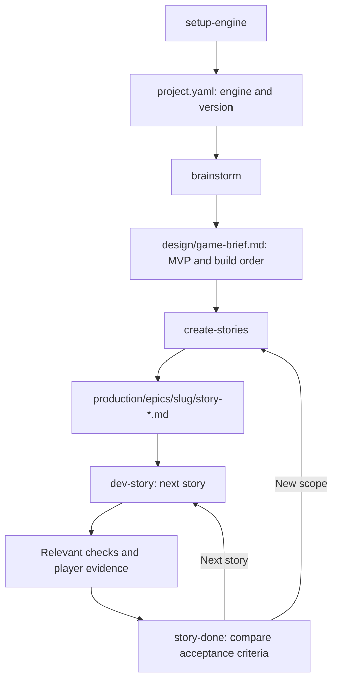
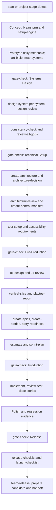
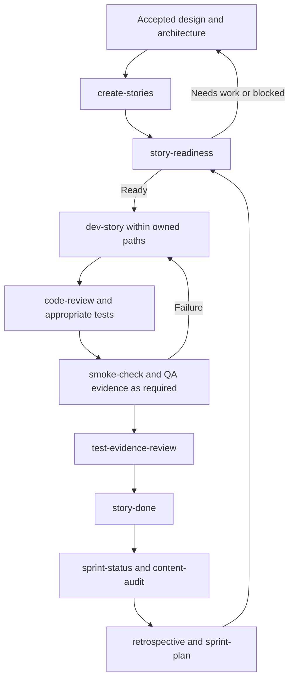
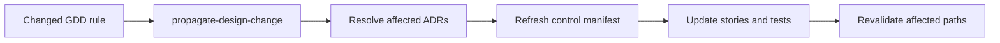
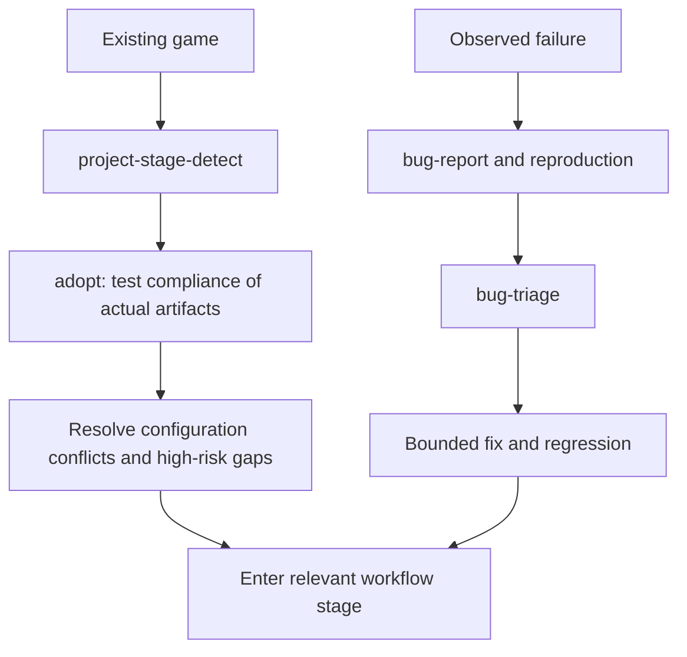
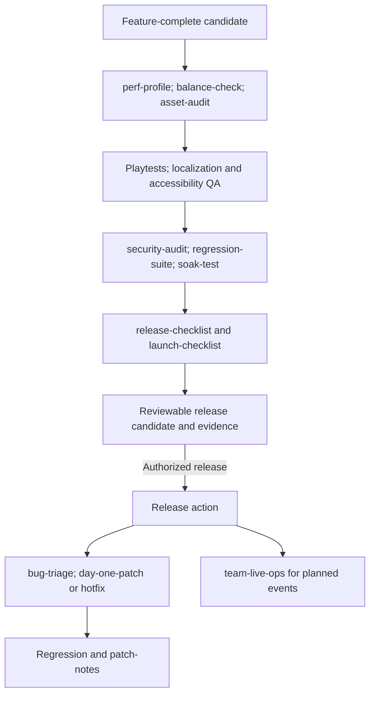

# Skill flow diagrams

These maps show useful order and artifact handoffs. Invoke a skill as
`$name` or through the available host skill UI; labels in diagrams are skill
names, not shell commands. Skills live in `.agents/skills/<name>/SKILL.md`.
Read the [workflow guide](WORKFLOW-GUIDE.md) for settings, gates, and execution
limits. The [workflow catalog](../.agents/docs/workflow-catalog.yaml) records
the phase requirements.

## Minimal route

The default rigor expands to a minimal workflow unless overridden. Its brief's
build order replaces separate epic and sprint planning requirements.

No phase transition gate is required on this route; the stage marker may remain
Concept. Other skills are available when useful. File presence alone does not
establish completion.

## Standard/full phase route

The arrows indicate review order. They do not mean a gate automatically permits
advancement or publishes a build. Apply the effective tier and record PASS,
CONCERNS, NOT ASSESSED, or FAIL. Missing playtests and unavailable independent
reviews remain visible. Release actions need applicable user authorization.

## Story and sprint loop

`qa-plan` defines testing scope; `team-qa` coordinates the testing cycle.
Static structure checks are not proof that a skill, engine, or client workflow
ran. A story closes only with evidence appropriate to its acceptance criteria.

## Design change propagation

Use `quick-design` for bounded story-sized changes, `scope-check` for scope
growth, and `reverse-document` when implementation lacks design records.

## Adoption and repair

See [configuration migration](migration-guide-v1.1.md) for the adapted legacy
converter. A current clone requires no historical source directory.

## Polish, release, and follow-up

Team skills describe coordination. Native delegation depends on actual host
support and authorization. Otherwise disclose an in-session role-guidance
fallback; do not label it independent review. Model choices follow host
capabilities and `.codex/model-policy.json`. Hooks and lifecycle helpers use
the [explicit CLI](codex/hooks.md); automatic native activation is PENDING
until verified.
